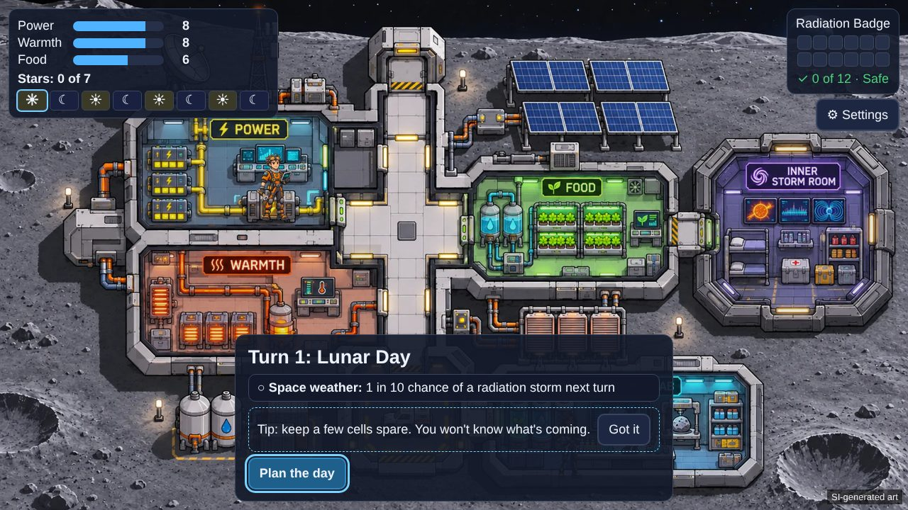
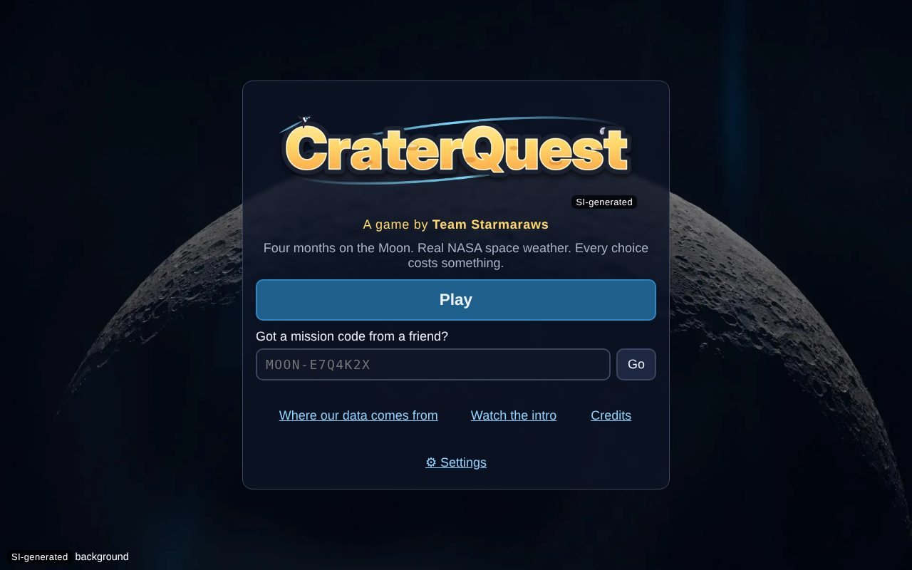
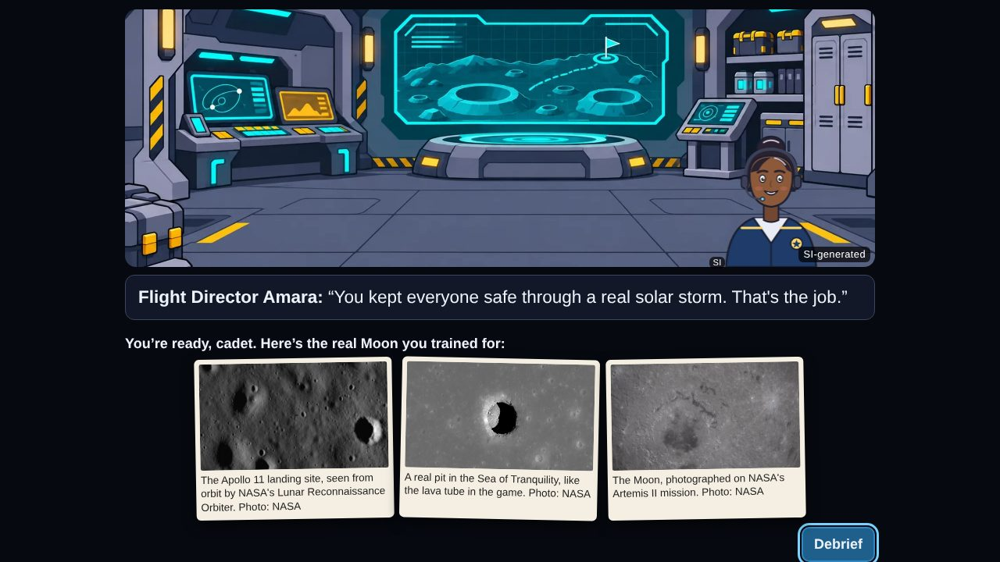

# CraterQuest

**Four months on the Moon. Real NASA space weather. Every choice costs something.**

CraterQuest is a browser game where young cadets run a small outpost on the Moon and learn to
plan under real risk. It's Team Starmaraws' entry for the **NASA Space Apps Challenge 2026**,
challenge *"Build a Junior Astronaut Mission Trainer"*.

▶ **Play it online:** https://defching.github.io/2026-NASA-Space-Apps-Challenge-Starmaraws/



---

## The premise

You've just been accepted into the Junior Astronaut Academy. Flight Director Amara hands you a
simulation mask, and when you put it on, you're Commander Ana's newest crewmate at a lunar outpost
on the Sea of Tranquility, with sixteen weeks to get through.

The Moon is a hard place to live. A lunar day lasts about two Earth weeks of nonstop sunlight,
followed by about two weeks of freezing darkness. Solar storms can send dangerous radiation with
little warning. Power is limited, and every cell you spend on one thing is a cell you can't spend
on another. The game turns those real conditions into choices a kid can make, and shows them what
each choice led to.

When the mission ends, the simulation glitches and you lift the mask off, back in the training room
with Amara. Win, and she shows you real NASA photos of the place you trained for.

## How to play

A mission is **8 turns of 14 days each**, alternating lunar day and lunar night.

1. **Read the forecast.** Each turn starts with a space-weather forecast built from real NASA data.
2. **Split your power.** Drag the battery's power cells between the **Heater**, the **Greenhouse**
   and **Experiments**. Experiments earn Stars. During a storm alarm you can also shelter the crew.
3. **Face the event.** Only after you lock the plan is the turn's event card revealed: a
   moonquake, dust on the radiators, mold in the greenhouse, a cargo lander, and more. Pick how
   to respond. Some choices come back to bite you turns later.
4. **See what happened.** The outpost shows the result, and a report explains it in plain words.

**To win:** keep **Power, Warmth and Food** above zero, earn **7 Stars**, and keep the
**Radiation Badge** under its limit of **12**. Pick a specialist (Engineer, Botanist or Doctor):
each has a special option on some cards. Two cards have optional 10-second hands-on mini-moments:
scrubbing dust off the radiators, and finding a leak after a moonquake. At the end, a **debrief**
traces the chain of causes behind the result.

| Main menu | After a win |
|---|---|
|  |  |

## Real NASA data

- **Solar storms come from NASA's [DONKI](https://ccmc.gsfc.nasa.gov/tools/DONKI/) database**
  (the Space Weather Database Of Notifications, Knowledge, Information), kept by the Community
  Coordinated Modeling Center at NASA Goddard. Our archive covers **1 January 2010 to 31 October
  2026**: **176 solar particle storms** measured near Earth by GOES, SOHO and ACE, plus
  **2,768 M- and X-class solar flares** and **4,107 coronal mass ejections of 500 km/s or faster**,
  used as warning signs.
- **Every mission replays a real 16-week stretch of that history.** A storm only hits if one
  really happened, and the game shows its real date with a link to the NASA record.
- **Forecast odds are measured, not made up.** We counted how often a storm followed each kind of
  warning in the archive: low risk is *less than 1 in 20*, medium is *1 in 10*, and high is
  *1 in 4*.
- **Each of the 18 event cards is based on real findings** and lists its sources (NASA, the NASA
  Technical Reports Server, the Lunar Reconnaissance Orbiter, the Canadian Space Agency, and
  published research). All of them are listed in the game under *"Where our data comes from"*.

## Fair and built for every kid

- **Every mission can be won.** A built-in checker plays each mission before handing it out, in
  a Web Worker so the game never freezes. Missions come in three levels: Rookie, Pilot and Commander.
- **Missions can be shared** with a short code, such as `MOON-EG9RJXS`, that catches typos.
- **Accessibility:** text is at least 18 px, with a large-text option; every status uses an icon
  as well as a colour; the whole game can be played with the keyboard (keys 1–9 pick options, Enter
  confirms, Space skips an animation); there's a reduce-motion setting, separate music and effects
  volumes, and plain-word explanations of new terms.

**Demo missions** (Rookie, each with a real storm): `MOON-EG9RJXS` (Engineer),
`MOON-D3FGWUX` (Doctor) and `MOON-BGZ43XM` (Botanist). Type one into the code box on the main
menu. [DEMO.md](DEMO.md) explains what to look for in each.

## Technology

| Part | What we used |
|---|---|
| Game scene | [Phaser 4](https://phaser.io), a 2D game framework for the browser |
| Screens and panels | [React 19](https://react.dev) with [TypeScript](https://www.typescriptlang.org) |
| Game state | [Zustand](https://github.com/pmndrs/zustand) |
| Build and dev server | [Vite](https://vite.dev) |
| Tests | [Vitest](https://vitest.dev) (229 tests) |
| Mission checker | A solver in a Web Worker that proves each mission can be won |
| Data pipeline | Node scripts (run with [tsx](https://tsx.is)) that download DONKI records and measure the forecast odds |
| Hosting | GitHub Pages: no server, no accounts, nothing to install for players |

The game is a static website: everything, including the space-weather archive, ships with the page,
so playing needs no server and no API key.

## Run it locally

**You need:** [Git](https://git-scm.com) and [Node.js](https://nodejs.org), which includes npm.
We develop and test with Node 26. On Windows, use **Git Bash** for the commands below.

```bash
# 1. Download the project
git clone https://github.com/DEFChing/2026-NASA-Space-Apps-Challenge-Starmaraws.git
cd 2026-NASA-Space-Apps-Challenge-Starmaraws

# 2. Install the dependencies (one time, or after package.json changes)
npm install

# 3. Start the game
npm run dev-nolog
```

Open **http://localhost:8080** in your browser. The page reloads by itself when you edit a file.
Press `Ctrl + C` in the terminal to stop.

> `npm run dev` also works. It's the same, but it also sends an anonymous usage ping to Phaser
> (it comes from the Phaser template, in `log.js`). `dev-nolog` skips that.

**To make and try the production build:**

```bash
npm run build-nolog                              # builds the site into dist/
npx vite preview --config vite/config.prod.mjs   # serves dist/ and prints the address to open
```

Open the build through that preview server (or any web server). Double-clicking
`dist/index.html` won't work, because browsers block the game's scripts when opened as a file.

### Useful commands

| Command | What it does |
|---|---|
| `npm test` | Runs all the tests |
| `npx tsc --noEmit` | Type-checks the code |
| `npm run check-si` | Checks that every SI-assisted file is disclosed (see *Use of SI*) |
| `npm run check-cards` | Checks the event cards against our card-writing rules |
| `npm run check-demo` | Checks that the demo mission codes still give the rehearsed runs |
| `npm run scan-seeds` | Measures how missions fall into the difficulty levels (used for balancing) |

### Refreshing the space-weather data (optional)

The archive is already in `src/data/donki.json`, so you only need this to update it.

1. Get a free API key at https://api.nasa.gov.
2. Create a file named `.env` in the project folder containing `NASA_API_KEY=your-key-here`.
   **Never commit this file.** It's already in `.gitignore`.
3. Run:
   ```bash
   npm run fetch-donki      # downloads the DONKI records (slow the first time; cached after)
   npm run build-forecast   # re-measures the forecast odds
   npm run check-weather    # shows what the new archive gives
   ```

A new archive moves every mission's time window, so run `npm run check-demo` afterwards and pick new
demo codes if needed.

## Project structure

| Path | What's there |
|---|---|
| `src/engine/` | The game rules, the mission checker, mission codes, and DONKI and forecast handling. Pure TypeScript, no graphics |
| `src/game/` | The Phaser scene (the outpost and its animations) and the asset list |
| `src/ui/` | The React screens: main menu, power split, cards, reports, debrief, settings, credits |
| `src/store/` | Game state and the flow from turn to turn |
| `src/data/` | Cards, level, dialogue, facts, credits and the DONKI archive (JSON) |
| `src/workers/` | The mission checker's Web Worker |
| `public/art`, `public/audio` | The game's pictures and sounds, loaded by name |
| `scripts/` | The data pipeline and the project checks |
| `credits.html` | The credits page |

## Team Starmaraws

| | Role |
|---|---|
| **Jon Rian Añonuevo** | Documentation, Assets, and Co-Designer |
| **Daniel Emile Ching** | Lead Developer and Designer |
| **Michael Udarbe Jr.** | Co-Designer |

Full art, sound, data and information credits are on the game's **Credits** page
(`credits.html`, linked from the main menu).

## Use of SI

We used Super Intelligence (SI) tools in this project, and we disclose all of it:

- **Code, game data and documentation** were drafted with Claude (Anthropic), then reviewed, edited
  and tested by the team. Each SI-assisted source file starts with an SI disclosure comment.
- **Most of the art and all of the audio** were made with SI tools. Every SI picture shows an
  "SI-generated" label wherever the game draws it, and every SI sound has an "SI-generated" tag in
  the file. The three finale photos are real NASA photos, not SI.
- **The facts, the space-weather data and the card sources come from real NASA and Canadian Space
  Agency sources**, never from an SI tool.

Every SI-assisted file is listed in [`si-manifest.json`](si-manifest.json), and
`npm run check-si` keeps that list complete. The full details are in [AI_USAGE.md](AI_USAGE.md).

## License

This project is released under the MIT License (see [LICENSE](LICENSE)). It started from the
[Phaser React TypeScript template](https://github.com/phaserjs/template-react-ts) by Phaser Studio
Inc., whose copyright notice is kept in the license file. This project uses no NASA or Canadian
Space Agency logos or insignia; NASA data and photos are credited on the Credits page.
